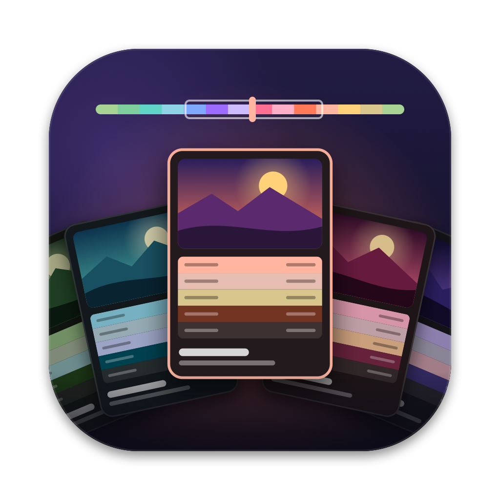
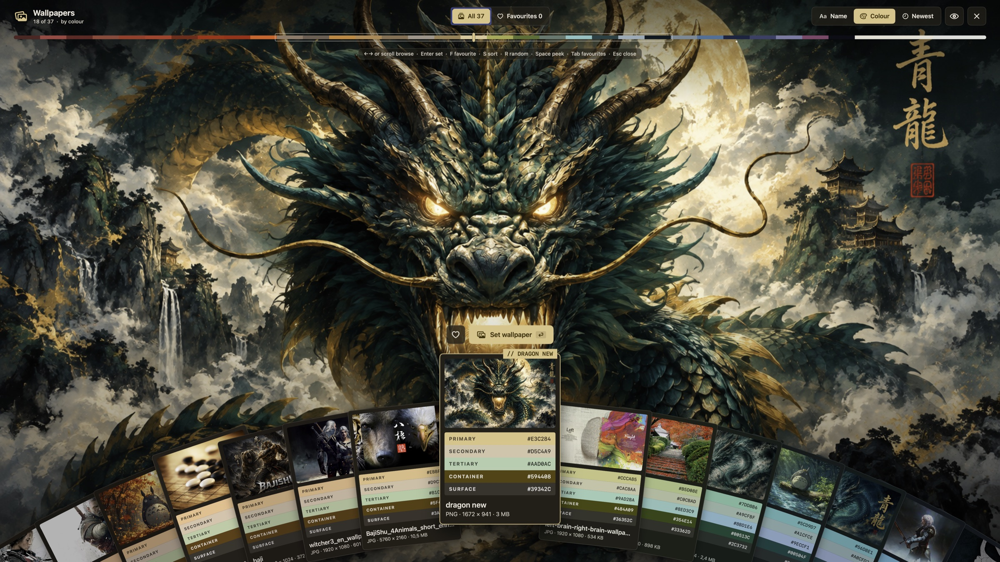

# Wallpaper Picker

A wallpaper picker for macOS. Your wallpapers are paint-chip cards fanned out
like a hand along the foot of the screen. Each card wears the Material-style
colour scheme read from its picture, and the card in front is previewed
full-screen behind the deck.

Inspired by [qs-wallpaperpicker](https://github.com/dhrruvsharma/qs-wallpaperpicker),
a wallpaper picker for Quickshell on Hyprland by
[u/dhruvsha](https://www.reddit.com/user/dhruvsha/). I saw it on Reddit and made
this macOS version. All credit for the idea and the design goes to them.



Requires macOS 14 or later.

## Install

With [Homebrew](https://brew.sh):

```sh
brew install pruzicka/tap/wallpaper-picker
open $(brew --prefix)/opt/wallpaper-picker/WallpaperPicker.app
```

If Homebrew says the tap isn't trusted yet, run
`brew trust --formula pruzicka/tap/wallpaper-picker` first. The formula builds the
app from source (about a minute), so macOS doesn't block it and no notarization
is needed.

Or from a clone, with nothing but the Command Line Tools (`xcode-select --install`):

```sh
./bundle.sh --install
```

This builds `WallpaperPicker.app`, copies it to `~/Applications`, adds a
`wallpaper-picker` command to `~/.local/bin`, and (re)starts the app.

The app lives in the menu bar and has no Dock icon. Open the picker with **⌃⌥W**,
from the menu bar icon, or by opening the app again. To use another shortcut,
pick one under **Shortcut** in the menu bar, or set any with
`wallpaper-picker --hotkey=cmd+shift+space`.

## Choosing the wallpaper folder

The default folder is `~/Pictures/Wallpapers`. To use another one:

```sh
wallpaper-picker --dir=~/Pictures/wallpapers
```

The app remembers the folder. If the app is running, it switches to the new
folder straight away; if not, the command starts it. You can also use
**Choose Folder…** in the menu bar.

It reads jpg, png, heic, webp, gif and tiff files, in the folder and in its
subfolders. New files show up while the app is running. Thumbnails and colours
are cached in `~/Library/Caches/WallpaperPicker`.

Favourites and fit modes are kept for each folder. They go by the file's name
and place in the folder, so renaming or moving a file loses its favourite and
fit mode.

### Subfolders as collections

Each subfolder of the wallpaper folder is a collection. **Folders** at the top
of the picker lists them, and `Tab` steps through All, Favourites and each
collection in turn. Images in deeper folders belong to the subfolder they're in.

## Changing the wallpaper by itself

**Change Wallpaper** in the menu bar sets a random wallpaper every 15 minutes,
hour, 3 hours or day, from everything or only the favourites. It doesn't repeat
one shown lately, and it waits while the picker is open. **Next Wallpaper** changes
it straight away.

## Command line

```
wallpaper-picker [--dir=PATH] [--show] [--set=FILE | --random [--favourites]]
                 [--rotate=INTERVAL] [--hotkey=KEYS]
  --dir=PATH         Take wallpapers from PATH (remembered; ~ works, also in quotes)
  --show             Open the picker
  --set=FILE         Set FILE as the wallpaper
  --random           Set a random wallpaper (not one shown lately)
  --favourites       With --random: only from the favourites
  --rotate=INTERVAL  Change the wallpaper by itself: off, 15m, 1h, 3h or 1d
  --hotkey=KEYS      The shortcut that opens the picker, e.g. ctrl+opt+w,
                     cmd+shift+space or f5
  --version          Show the version
  --help             Show this help
```

The commands go to the running app, or start it. `--random` and `--set` work
from Shortcuts, Raycast, cron or a launchd job as well as from a terminal.

## Keys

| | |
|---|---|
| `←` `→`, scroll, trackpad swipe, drag | browse |
| `Enter`, click the front card | set as wallpaper (all displays) |
| `F` | favourite |
| `S` | sort: name → colour → newest |
| `R` | random |
| `M` | fit: fill → fit → stretch → center (remembered per wallpaper) |
| `Space` | hold to peek, tap to toggle |
| `Tab` | all → favourites → each subfolder |
| `Home` `End` `PgUp` `PgDn` | jump |
| `Esc` | close |

Right-click a card to set it, favourite it, change its fit, copy its colours,
show it in Finder or move it to the Trash. Click a colour on the card in front
to copy its hex code.

## Notes

- macOS sets a wallpaper for the current Space only. Turn on **Show on all Spaces**
  in System Settings › Wallpaper to have it everywhere.

## Fitting the screen

Each wallpaper remembers how it meets the screen, like the menu in System Settings:
**Fill** (crop to cover), **Fit** (whole picture, the edges filled with its border
colour), **Stretch**, or **Center** (its own size). The preview shows the result
before you set it. Tile isn't offered: macOS has no public way for apps to set it.

## Development

```sh
./dev.sh                  # debug build, run from here, open the picker
./dev.sh --dir=~/folder   # with another folder (kept separate from the installed app)
./test.sh                 # the tests (Swift Testing; Command Line Tools are enough)
./bundle.sh --install     # install when happy
```

Quit the installed app before `./dev.sh`, or both copies will want ⌃⌥W. The two
keep separate settings but share the favourites, fit modes and caches in
`~/Library/Application Support/WallpaperPicker` and `~/Library/Caches/WallpaperPicker`.

| File | What's in it |
|---|---|
| `main.swift`, `Options.swift` | command line, handing commands to the running app |
| `App.swift` | menu bar, global hotkey, the full-screen panel, commands |
| `HotKeySpec.swift` | the shortcut: parsing `ctrl+opt+w`, showing ⌃⌥W |
| `Library.swift` | the folder and subfolders: scanning, watching, favourites, setting the wallpaper, analysis and cache upkeep |
| `Rotation.swift` | changing the wallpaper by itself, Next, `--random` |
| `Images.swift` | thumbnails, previews, caches |
| `ColorScience.swift` | Lab colour, seed extraction, the tonal scheme |
| `Motion.swift` | display-linked animation of the deck |
| `PickerModel.swift` | the hand's geometry, state, keys and scrolling |
| `PickerView.swift` | everything on screen |

## Licence

[GPL-3.0](LICENSE), the same as qs-wallpaperpicker, whose design and card
layout this app is modelled on.
